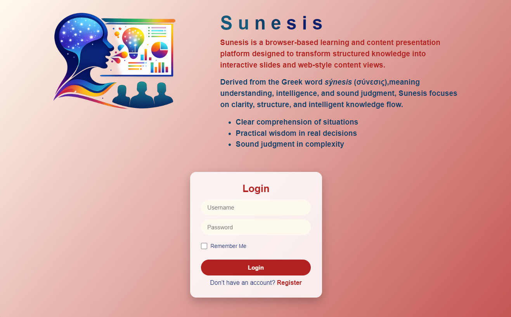
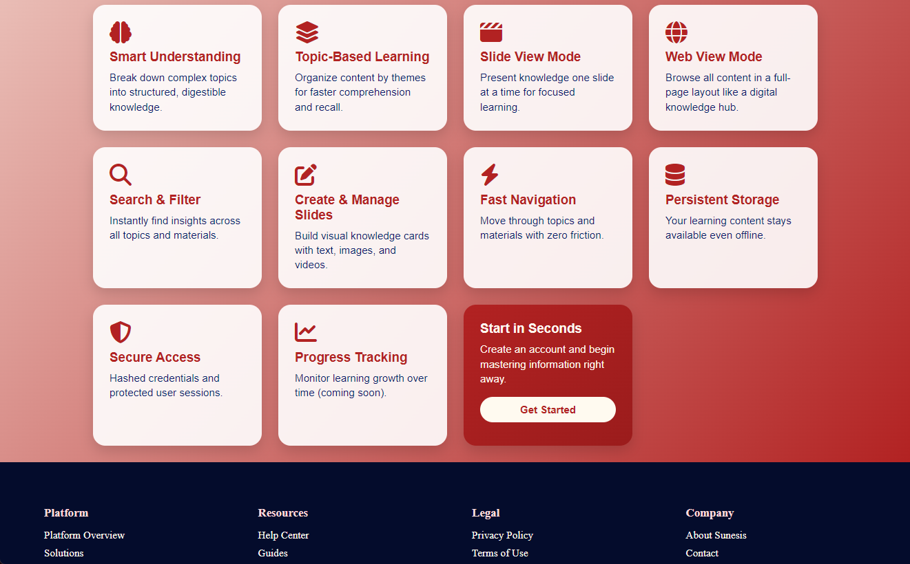
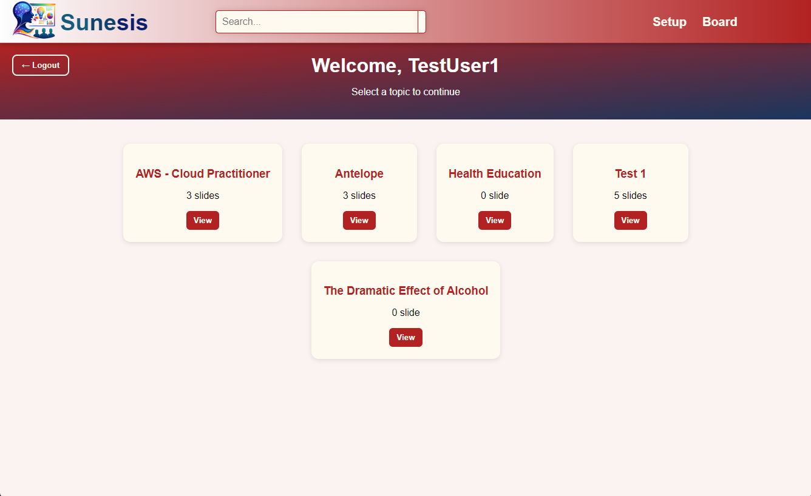
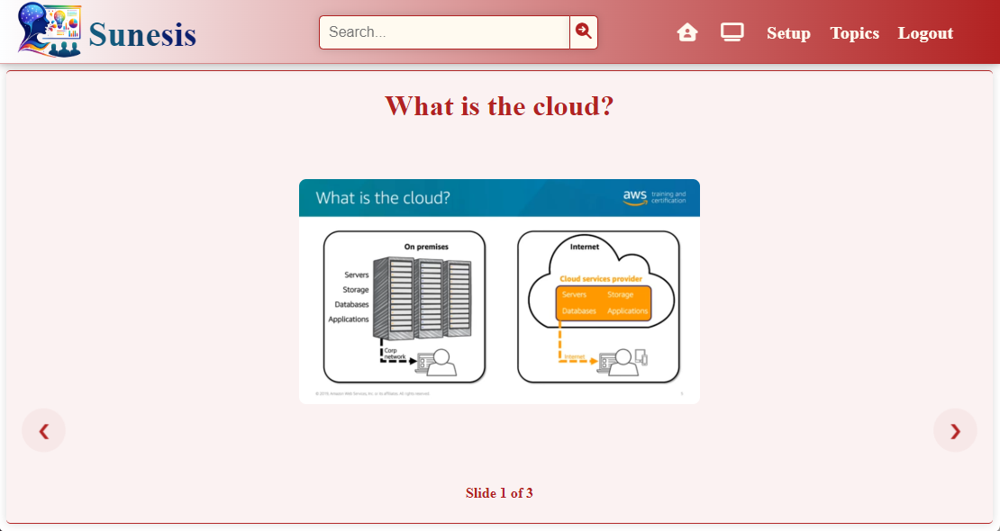
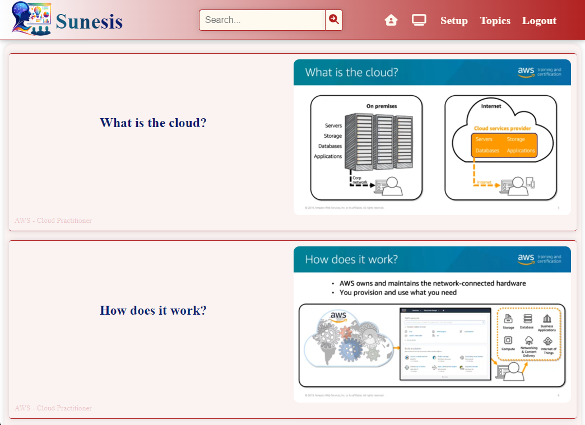

# Sunesis — Intelligent Learning & Knowledge Presentation Platform

## What is Sunesis?

**Sunesis** is a multi-user learning and presentation web platform. It allows users to:

- Create accounts with secure authentication
- Create Topic(s) and add slide(s) with rich content
- View organized presentations in both slide and web mode
- Manage personal content with permission-based access
- Search across all available content
- Access admin controls for full system management

Sunesis is designed to be lightweight, fast, and accessible directly from a web browser with no server required.

---

## Who is Sunesis for?

Sunesis is built for:

- Students and learners seeking structured knowledge
- Educators and presenters creating content
- Organizations needing shared learning platforms
- Anyone who wants topic-based content in a clean, multi-user interface

No technical knowledge is required to use the platform.

---

## How Sunesis Works (Simple Explanation)

1. You open the Sunesis website
2. You register or log in using a username and password
3. You can view all available topics and slides created by any user
4. You can create your own topics and slides for others to view
5. You can manage only the content you created (or use admin access)
6. Your login can be remembered on your device if you choose

All data is stored safely in your browser. No external servers are required.

---

## Screenshots

### Home page



### Features



### User Home Page



### Slide View Mode



### Web View Mode



---

## Features

### Multi-User Authentication

- Secure password hashing (SHA-256)
- Login & registration system
- Remember-me functionality
- Session-based access control
- Case-insensitive username handling

### Permission-Based Content Management

- **All users can view** all topics and slides
- **Users can create** their own topics and slides
- **Users can manage** only their own created content
- **Admin user** can manage all content system-wide
- Creator attribution on all content

### Topic & Slide Management

- Create unlimited learning topics
- Add text, images, and videos to slides
- Rich text formatting support (bullets, paragraphs)
- Organize slides by topic
- Delete individual slides or entire topics (permission-based)

### Multiple Viewing Modes

- **Slide View Mode** — focused presentation, one slide at a time
- **Web View Mode** — full content browsing like a knowledge website
- **Account Dashboard** — overview of all available topics

### Smart Search

**Search across:**

- Slide titles
- Descriptions
- Topics
- Content creators

**Works in:**

- Admin dashboard (Setup)
- Slide view
- Web view
- Account page

### Modern UI/UX

- Responsive layout with mobile optimization
- Interactive tooltips on navigation elements
- Color-coded tooltips (firebrick on desktop, blue on mobile)
- Smooth scrolling and transitions
- Feature-based homepage
- Real-time password validation
- Popup notifications for user feedback

### Persistent Storage

- Uses IndexedDB for high-performance browser storage
- Offline-first access with local persistence
- Syncs with Supabase PostgreSQL backend when online
- Creator and timestamp tracking
- No server required for offline usage

---

## Tech Stack

### Layer & Technology Used

**Frontend:** HTML5, CSS3, JavaScript (ES6+)
**Storage:** IndexedDB with creator tracking
**Security:** Web Crypto API (SHA-256 hashing)
**Architecture:** Client-side SPA with permission layers
**UI Icons:** Font Awesome 6
**Responsive Design:** CSS Grid and Flexbox

---

## Backend & Sync Support

Sunesis now includes a Node.js backend that connects to Supabase PostgreSQL for online persistence.

- Express API server in `backend/server.js`
- Supabase PostgreSQL tables for `users`, `topics`, and `slides`
- Remote auth with account persistence across devices
- Offline mode retained using IndexedDB in the browser
- Automatic sync between local IndexedDB and the backend when connectivity returns
- Admin account manages all content globally, normal users manage only their own created content

### Backend Setup

1. Setup `backend/.env`.
2. Set `SUPABASE_URL`, `SUPABASE_SERVICE_ROLE_KEY`, and `JWT_SECRET`.
3. Run `npm install` inside `backend` and start the server with `npm start`.
4. Provision the Supabase schema using `backend/schema.sql`.

---

## Security Note (Important)

Sunesis uses browser storage for learning and demonstration purposes.

It is **not intended for sensitive or production-level data**.

For production use, implement server-side authentication and database storage.

---

## How It Works

### Data Structure

1. **Topics**
   Topics are stored in IndexedDB with creator information:

```javascript
{
  name: "About Sunesis",
  creator: "username"
}
```

2. **Slides**
   Slides are linked to topics with creator and timestamp:

```javascript
{
  id: 1,
  topic: "About Sunesis",
  title: "Sunesis Platform",
  desc: "Learning to use the platform",
  media: "base64-data",
  type: "image",
  creator: "username",
  createdAt: "2024-01-01T00:00:00.000Z"
}
```

3. **Users**
   User accounts with role-based permissions:

```javascript
{
  username: {
    password: "hashed-password",
    role: "user" // or "admin"
  }
}
```

### Permission Model

- **Visibility ≠ Permission**: All users can see all content
- **Write/Delete Authorization**: Users can only modify their own content
- **Admin Override**: Admin user can manage all content
- **Creator Attribution**: All content shows who created it

### Viewing Logic

- **Slide View**: Filters by topic and navigates one-by-one
- **Web View**: Displays all slides as content sections
- **Account Page**: Shows all topics with creator info
- **Admin Page**: Shows user-manageable content with delete controls

---

## User Roles & Permissions

### Normal Users

- View all topics and slides
- Create new topics and slides
- Edit/delete only their own content
- Access all viewing modes
- Use search functionality

### Admin User

- All normal user permissions
- View/manage all topics and slides
- Delete any content system-wide
- Access "Delete All" functionality
- Full system administration

**Note:** Admin role is assigned to username "admin" during registration.

---

## User Flow

1. **Registration/Login**
   - Create account or login
   - Admin account uses username "admin"

2. **Content Discovery**
   - Browse all available topics on account page
   - View creator information for each topic

3. **Content Creation**
   - Create personal topics
   - Add slides with text, images, videos
   - Use rich text formatting

4. **Content Viewing**
   - Slide View: Sequential presentation
   - Web View: Full content browsing
   - Search across all content

5. **Content Management**
   - Manage personal content on setup page
   - Admin manages all content
   - Delete with permission checks

---

## Security Notes

- Passwords never stored in plain text
- Hashed using SHA-256 before storage
- Session-based access control
- Remember-me stored separately from password
- Permission checks on all write operations
- For production: backend auth and database recommended

---

## Author

Developed by **CyprianchuX**

---

## License

This project is for educational and learning purposes.
